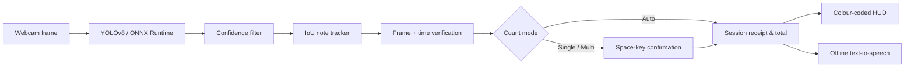

# INR Cash Counter — Real-Time Indian Currency Detection

[](https://www.python.org/)
[](https://opencv.org/)
[](https://docs.ultralytics.com/models/yolov8/)
[](https://onnxruntime.ai/)
[](LICENSE)

> **INR Cash Counter** turns a webcam into a live Indian-note counter. A YOLOv8
> detector identifies visible notes, tracks them across frames, verifies them
> before counting, and announces a running total through offline speech.
> Detection boxes use the distinctive colour of the detected denomination for
> immediate visual recognition.

---

## Table of Contents

- [Why INR Cash Counter](#-why-inr-cash-counter)
- [Feature Overview](#-feature-overview)
- [Detection Pipeline](#-detection-pipeline)
- [Engineering Highlights](#-engineering-highlights)
- [Tech Stack](#-tech-stack)
- [Quick Start](#-quick-start)
- [Controls & Count Modes](#-controls--count-modes)
- [Train and Export a Model](#-train-and-export-a-model)
- [Project Structure](#-project-structure)
- [Known Limitations](#-known-limitations)
- [Accuracy & Safety](#-accuracy--safety)
- [License](#-license)

---

## ✨ Why INR Cash Counter

| | |
|---|---|
| 🎥 **Live, hands-free counting** | Show a note to the camera and Auto mode counts it only after stable verification—no clicking required. |
| 🎨 **Denomination-coloured overlays** | Each box matches the note it identifies: green ₹5, brown ₹10, yellow-green ₹20, turquoise ₹50, lavender ₹100, orange ₹200, and stone-grey ₹500. |
| 🧾 **Receipt-style session view** | Watch per-denomination quantities, subtotals, total notes, and the grand total update in real time. |
| 🔊 **Accessible by design** | Offline text-to-speech announces counted notes and running totals, making the workflow practical without looking at the screen. |
| ⚡ **Hardware-aware inference** | Run standard PyTorch YOLOv8 or export to ONNX Runtime, which prioritises QNN NPU, DirectML GPU, then CPU. |

---

## 🎯 Feature Overview

### Detect & Count

- **Seven INR denominations** — ₹5, ₹10, ₹20, ₹50, ₹100, ₹200, and ₹500.
- **Three workflows** — automatic stable-note counting, manual single-note confirmation, and manual multi-note batch commit.
- **IoU note tracking** — follows multiple visible notes across fresh inference results and prevents a stable note from being counted twice.
- **Time-based verification** — a note must remain visible for a configurable period (3 seconds by default) before Auto mode counts it.
- **Adjustable confidence** — tune the live confidence threshold using `+` and `-`.

### Feedback & Review

- **Live colour-coded HUD** — detection brackets, tags, and receipt dots match the denomination being detected.
- **Offline speech feedback** — announces individual notes, batches, the running total, and the final session summary.
- **Session controls** — pause tracking, reset the receipt, change mode, and hear the total without restarting.
- **Suspicious-note flagging** — an optional visual heuristic can flag a note for manual review during manual counts.
- **On-screen control bar** — every keyboard shortcut is also a clickable button under the camera view, so the counter is fully usable with a mouse or touch input alone.

---

## 🏗 Detection Pipeline



---

## 🔬 Engineering Highlights

### 1 · Fresh-inference tracking

The tracker updates only when a new detector result arrives, rather than
reusing a stale bounding box for every camera frame. This makes the
three-frame stability check meaningful and keeps multi-note commits reliable.

### 2 · Stable counting without duplicate totals

Each tracked note has a unique ID, bounding box, time first seen, active-frame
count, and `counted` state. Auto mode counts a note once after it satisfies the
frame and time checks; Multi mode commits only qualifying, uncounted notes.

### 3 · Portable acceleration path

The counter supports `.pt` weights directly through Ultralytics and `.onnx`
exports through ONNX Runtime. ONNX inference attempts Qualcomm QNN NPU first,
then DirectML GPU, and uses CPU as a reliable fallback.

---

## 🧰 Tech Stack

| Layer | Technologies |
|---|---|
| **Detection** | Ultralytics YOLOv8 · PyTorch · ONNX Runtime |
| **Vision** | OpenCV · NumPy |
| **Tracking** | Lightweight IoU tracker implemented in Python |
| **Feedback** | `pyttsx3` offline text-to-speech |
| **Training** | YOLOv8 dataset merge, class mapping, training, and ONNX export scripts |

---

## 🚀 Quick Start

**Prerequisites:** Python 3.10+ and a connected webcam.

```bash
git clone https://github.com/anshuldhiman-ai/Currency-Counter-using-OpenCV.git
cd Currency-Counter-using-OpenCV

python -m venv .venv
.venv\Scripts\activate
pip install -r requirements.txt
```

Sarvam AI speech needs an API key. Copy `.env.example` to `.env` and fill in
your key (`.env` is gitignored — the app falls back to offline `pyttsx3`
speech automatically if the key is missing):

```bash
copy .env.example .env
```

Place your trained model at `models/best.pt`, then start automatic counting:

```bash
python live_count.py --model models/best.pt --mode auto
```

> 💡 Model weights are deliberately excluded from Git because they are large
> binary files. Download the model separately or train one using the steps
> below, then place it under `models/`.

### Useful run commands

```bash
# Use camera 1 and verify a note for 2 seconds before auto-counting it.
python live_count.py --cam 1 --mode auto --verify_time 2

# Manually commit every verified visible note with Space.
python live_count.py --mode multi

# Run a converted ONNX model.
python live_count.py --model models/best.onnx --mode auto
```

---

## ⌨️ Controls & Count Modes

Every action below is available both as a keyboard shortcut and as a clickable
button in the on-screen control bar rendered under the camera view.

| Key | Action |
|---|---|
| `M` | Cycle modes: **Single → Multi → Auto** |
| `Space` | Count best visible note in Single; commit verified notes in Multi |
| `C` | Clear the receipt and total |
| `P` | Pause or resume tracking |
| `R` | Speak the running total |
| `+` / `-` | Increase or decrease confidence threshold |
| `Q` / `Esc` | End session and announce the summary |

| Mode | Behaviour |
|---|---|
| **Auto** | Counts each stable note once after the verification period. Move a counted note away before showing the next one. |
| **Multi** | Hold several notes in view until verified, then press `Space` to commit the batch. |
| **Single** | Press `Space` to count the currently highest-confidence note. |

---

## 🧠 Train and Export a Model

1. Place YOLOv8-format datasets in `data/raw/<dataset-name>/`.
2. Combine datasets and normalise their class labels:

   ```bash
   python merge_datasets.py
   ```

3. Train the detector:

   ```bash
   python train.py
   ```

4. Export trained weights to ONNX when needed:

   ```bash
   python export_onnx.py --model models/best.pt --imgsz 640
   ```

---

## 📁 Project Structure

```text
Currency-Counter-using-OpenCV/
├── live_count.py            # Main webcam counter, HUD, controls, and session state
├── train.py                 # YOLOv8 training entry point
├── merge_datasets.py        # Dataset merge and class normalisation
├── export_onnx.py           # PyTorch-to-ONNX export utility
├── requirements.txt         # Python dependencies
├── data/
│   └── raw/README.md        # Dataset placement guidance
├── models/                  # Local trained weights (ignored by Git)
└── utils/
    ├── tracker.py           # IoU tracking and stability verification
    ├── onnx_runner.py       # ONNX Runtime inference and provider fallback
    ├── fake_check.py        # Basic suspicious-note heuristic
    └── tts_engine.py        # Offline text-to-speech wrapper
```

---

## 🚧 Known Limitations

- **Class imbalance affects accuracy.** Detection quality depends heavily on how
  many training examples exist for each denomination. Notes with fewer training
  images (historically ₹200 and ₹500) are detected less reliably until the
  dataset is rebalanced. Merge additional datasets and retrain to improve them.
- **Note-design coverage matters.** The model only recognises note designs it was
  trained on. A new-series design absent from the training data may be missed or
  misclassified even if an older design of the same denomination works.
- **Overlapping / stacked notes.** Each detected box counts as one note. Notes
  that overlap or are fanned in a hand can hide each other, so heavily occluded
  stacks may under-count. Show notes separated and non-overlapping for best
  results.
- **Low-confidence fallback.** When unsure, the detector can emit a low-confidence
  guess. Tune the confidence threshold (`+` / `-`, or `--conf`) for your camera
  and lighting to suppress spurious detections.

---

## ⚠️ Accuracy & Safety

- Detection accuracy depends on the quality, lighting, orientation, and class
  coverage of the trained model. Validate it with your own notes and camera
  setup before relying on totals.
- The suspicious-note check is a simple image heuristic, **not** counterfeit
  authentication. Never use it for banking, compliance, or high-stakes
  financial decisions.
- Treat the application as a counting assistant, not a replacement for manual
  verification when handling cash professionally.

---

## 📄 License

Released under the [MIT License](LICENSE) — free to use, modify, and distribute.

<p align="center"><sub>Built to make everyday INR cash counting faster, clearer, and more accessible.</sub></p>
